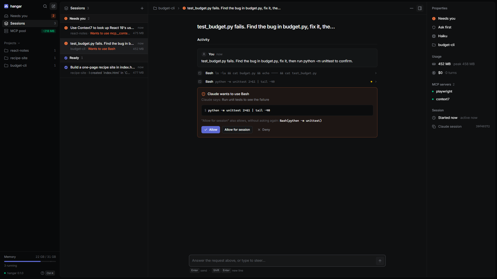
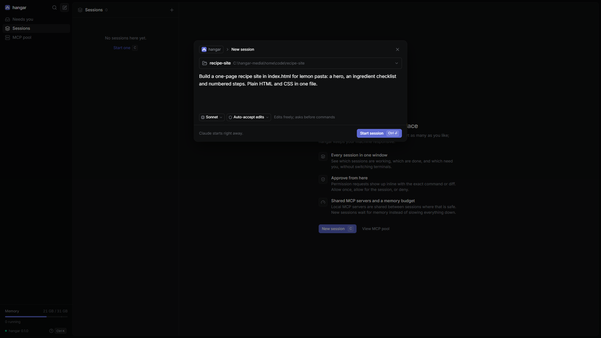
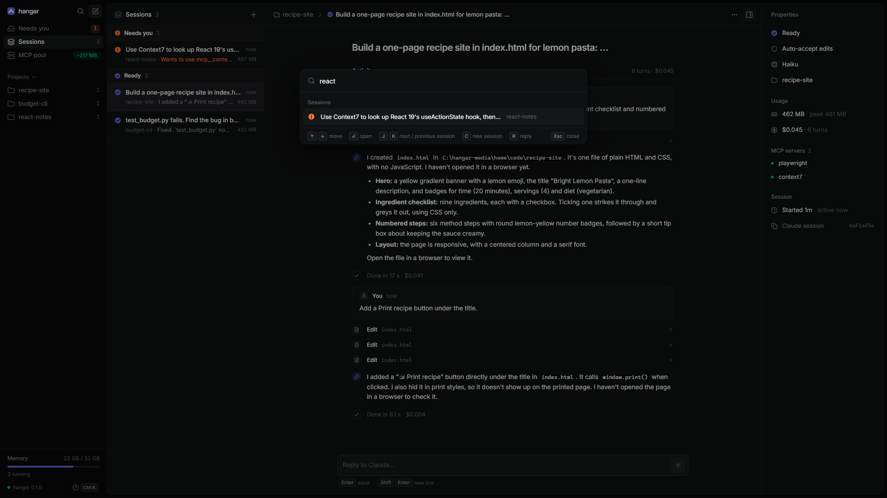
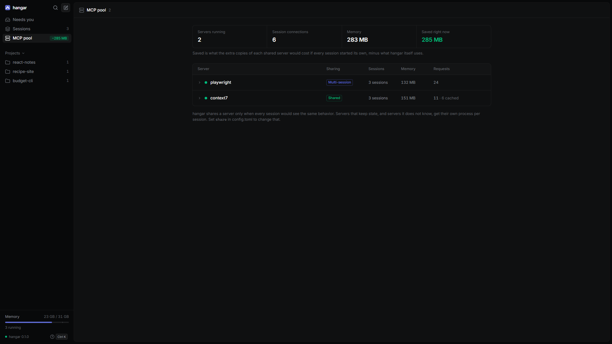

# hangar

**One window for all your Claude Code agents.** Give each agent its own folder and task. See at a glance which agents are working, which are done and which are waiting for you. Approve their commands without hunting through terminal tabs, and move between them with the keyboard. hangar also shares local MCP servers between them where that is safe, and a memory budget keeps a crowd of agents from slowing your PC down.

<p align="center">
  
</p>
<p align="center"><em>A real recording: three Claude Code sessions work at once. Waiting for Claude is sped up. <a href="docs/media/demo.mp4">Full-resolution video (MP4)</a>.</em></p>

## Run many agents without losing track



- **Every session in one list, grouped by what it needs from you:** *Needs you*, *Working*, *Queued*, *Ready* and *Paused*.
  - The sidebar filters to what needs you, or to one project.
  - The window title counts the sessions waiting for you.
  - A desktop notification tells you when a session needs you, finishes or fails.
- **Approvals inline.** When Claude wants to run a command or edit a file, you see the exact command, file contents or diff, with *Allow*, *Allow for session* and *Deny*. Whatever you type in the reply box steers Claude instead.
  - Nothing in a request can hide: long ones must be opened in full before Allow works, and invisible characters are written out.
  - *Allow for session* shows the rule it adds.
- **Settings per session.** Each session gets a folder, a model (Opus, Sonnet or Haiku) and a permission level: ask first, accept edits, plan only or full access. Both the model and the permission level can be changed mid-session.
- **A feed per session.** It shows messages, tool calls you can expand, and each turn's time and cost. A properties panel shows the session's status, model, memory, cost and MCP servers.
- **History that lasts.** Sessions outlive restarts. A stopped or paused session carries on in the same conversation when you send your next message.
- **Light or dark.** hangar follows your system. To pin one, press `Ctrl K` and type *theme*.
- **Keyboard first:**

| Key | |
|---|---|
| `Ctrl K` | command palette: jump to any session or action by typing part of its name |
| `C` | new session |
| `J` / `K` | next / previous session |
| `R` | reply to the open session |
| `Esc` | stop the running turn |
| `Ctrl \` | show or hide the sidebar |

<p align="center">
  
  
</p>

## Shared MCP servers

MCP servers come in two kinds:

- **Remote servers** run on the provider's machines, and Claude Code connects to them over the internet. Examples are GitHub's hosted server, Linear, Notion and the connectors in your Claude account. They use next to nothing on your PC, so hangar has nothing to share.
- **Local servers** are programs that Claude Code starts on your PC, because they need something on it:
  - Playwright drives a real browser.
  - Filesystem and Git work on your files.
  - A database server reaches a local database.
  - Some, like Context7 (current library documentation), run locally and call a web service.

Claude Code starts its own copy of every local server for every session. On Windows an `npx` server is a tree of five processes taking about 150 MB. hangar runs one copy of every server that can safely be shared, and starts the others as a single process each.

Real Claude Code sessions with Playwright and Context7, measured by `hangar bench`:

| Without → with hangar | 1 session | 3 sessions | 5 sessions |
|---|---:|---:|---:|
| MCP memory | 340 → 149 MB | 1016 → 294 MB | **1.65 GB → 441 MB (−74%)** |
| MCP processes | 11 → 8 | 33 → 18 | 55 → 28 |
| CPU spent starting servers | 3.3 → 2.2 s | 11.8 → 5.2 s | 21.7 → 8.2 s |
| Time until tools are ready (p95) | 2.6 → 1.3 s | 3.4 → 1.5 s | 5.2 → 2.2 s |

- **What is shared.** Context7 runs once for every session. Playwright still runs once per session by default, but as one process instead of a five-process tree.
- **One shared browser is opt-in** (see [The pool](#the-pool)). With it on, 5 sessions take 170 MB (−90%), about the same as one session. When every session also drives its browser, 5 sessions take 2.95 GB without hangar, 1.74 GB with it, and 713 MB with the shared browser.
- **Five servers.** With Playwright, Context7, Memory, Sequential Thinking and Filesystem, 3 real sessions drop from 2.42 GB to 755 MB (−70%), and 10 simulated ones from 7.38 GB to 2.08 GB.
- The method and every table are in [bench/README.md](bench/README.md).

**Nothing is traded away.** `hangar verify` sent the same tool calls to each server both directly and through the pool. **21 of 21 answers were identical**, and the pool added about 0.1 ms per call. Real Claude Code (Haiku) tasks that need MCP succeeded 9 of 9 times both ways ([verify.md](bench/results/verify.md)).

**What it does not save is tokens.** Every session still receives each server's tool list, exactly as without hangar.



*The pool page, here with the shared Playwright browser turned on.*

## Quick start

You need Rust 1.89+, Node 22+, Claude Code (`npm i -g @anthropic-ai/claude-code`) and Windows 10 or later. Linux and macOS pass `cargo check` but have not been run yet.

```sh
cd web && npm ci && npm run build && cd ..
cargo build --release
./target/release/hangar up
```

`hangar up` is the only command you need each time:
- It starts hangar in the background if it isn't running, and opens the app.
- If your default browser is Chrome or Edge, the app opens as its own window.
- Closing the window leaves your sessions running. `hangar stop` ends hangar and every session.
- To start it from anywhere, put `target/release` on your `PATH`, or make a shortcut to `hangar.exe up`.

**Make it an app of its own (optional, Chrome or Edge).** In hangar, press `Ctrl K`, type *install* and choose **Install hangar as an app**.
- hangar gets its own taskbar and Start menu icon, drawn at full sharpness.
- Its title bar takes the app's color. Click the `^` in the title bar to hide it altogether.
- From then on, `hangar up` opens the installed app.

## Commands

| Command | What it does |
|---|---|
| `hangar up` | Starts hangar if needed and opens the app. `--no-open` prints a one-time sign-in link instead. |
| `hangar stop` | Stops hangar, every session and every MCP server it runs. Sessions resume from where they were next time. |
| `hangar status` | Shows the shared MCP servers: how they are shared, how many sessions use each, memory, requests, cache hits and restarts. |
| `hangar wrap` | Makes the Claude Code sessions you start in a terminal share local MCP servers too. `--dry-run` previews the change. |
| `hangar unwrap` | Undoes `wrap` exactly. |
| `hangar bench` | Measures memory, CPU and startup time for N sessions, with and without the pool, on your machine. |
| `hangar verify` | Checks that pooled servers answer exactly like direct ones, and times each call. |

**`hangar wrap`.** Sessions started from the app already share servers. `wrap` is for the `claude` you run in a terminal.
- It rewrites each local (stdio) server in `~/.claude.json` to start through `hangar-shim`. A server's project `.mcp.json` file is not changed.
- It makes a backup first, and skips remote servers and servers that are already wrapped.

```jsonc
// before
"playwright": { "command": "npx", "args": ["@playwright/mcp@latest", "--isolated"] }
// after
"playwright": { "command": "C:\\…\\hangar-shim.exe", "args": ["--name", "playwright", "--", "npx", "@playwright/mcp@latest", "--isolated"] }
```

Claude Code then starts the shim instead of the server. The shim is a 900 KB program that uses about 1.2 MB of memory. It passes messages between Claude Code and hangar's single copy of the server. It also starts hangar if it isn't running, and falls back to running the server itself if hangar can't be reached, so wrapping never breaks a server.

**`hangar status`**, with the three sessions from the video running (the video turns the shared Playwright browser on):

```
hangar daemon 0.1.0 (pid 18188), up 1m, 9 MB

SERVER                 SHARE    STATE          PID SESSIONS     MEMORY REQUESTS CACHED RESTARTS
playwright             native   ready        30368        3     134 MB       13      0        0
context7               global   ready        32888        3     121 MB        9      6        0

2 servers, 6 session attachments, 254 MB total
```

**`hangar bench`** runs real headless Claude Code (`--agent claude`) or a minimal MCP client (`--agent sim`, the default). It never sends a prompt, so it costs no tokens. Use `--preset` with your own `.mcp.json` to measure your setup:

```sh
hangar bench --agent claude --preset bench/presets/playwright-context7.json --sessions 1,3,5
hangar bench --preset .mcp.json --sessions 1,5,10 --out my-results
```

**`hangar verify`** compares direct and pooled answers for five servers. `--with-claude` also runs real Claude Code (Haiku) tasks both ways, which costs a few cents.

## How it works

### Sessions

Each session is a headless `claude` process. It speaks the stream-json control protocol that the official Agent SDKs use.
- Permission prompts arrive as `can_use_tool` requests and wait for you in the app.
- Model and permission changes go to the running process (`set_model`, `set_permission_mode`). A permission change applies at once; a model change applies from the next turn.
- Events are kept in `~/.hangar/sessions/<id>/events.jsonl`.

A folder's own Claude settings can run commands (hooks), pre-approve tools and start MCP servers. Interactive Claude Code asks before trusting a new folder, but headless mode doesn't, so hangar asks instead.
- The first session in a folder shows what its settings would do: hooks, pre-approved tools, MCP servers with their full command lines, and every other setting. It starts only after you confirm.
- Your confirmation covers what was shown. If the settings changed since, hangar asks again.
- A new folder you create from the app is empty, so it needs no confirmation.

"Allow for session" remembers a rule inside that Claude process only, never in the project's settings files.

### The memory budget

The budget decides when a session may start. It never slows down a session that is already running.
- **When it applies.** A session starts, or resumes, only if a reserve of free memory remains after its expected cost. The reserve is the larger of 2 GB and 10% of RAM.
- **The expected cost** is the median peak of your recent sessions (600 MB until hangar has seen some). The sidebar shows how many more sessions fit.
- **When there isn't room,** the session waits in the queue. hangar first pauses idle sessions to make room, longest idle first.
- **Idle** means the session finished its turn, isn't waiting for you, and has been quiet for 30 seconds. A session that is working or waiting for an approval is never paused.
- **Pausing** ends the `claude` process, which holds 400–470 MB on this machine. Your next message resumes the conversation with `--resume`, so Claude sees the whole history.
- **What a pause loses** is what lived only in that process: background commands it started, a browser page an MCP server had open, and "Allow for session" rules.

### The pool

```
 Claude Code session A ──stdio──> hangar-shim ─┐
 Claude Code session B ──stdio──> hangar-shim ─┼─loopback──> hangar daemon ──stdio──> context7   (one process)
 Claude Code session C ──stdio──> hangar-shim ─┘   (secret)       └──stdio──> playwright (one per session,
                                                                               unless you turn sharing on)
```

Every request carries an id that its session chose, so two sessions can both send request 1. The daemon gives each request a fresh id on its way to the server, and puts the original back on the answer:

```
A: #1 resolve-library-id "react"  →  server: #101 …   server: #101 → result  →  A: #1 → result
B: #1 resolve-library-id "vite"   →  server: #102 …   server: #102 → result  →  B: #1 → result
```

Progress updates and cancellations are mapped the same way, so they reach only their own session. A notice meant for everyone, such as a changed tool list, goes to every session. The server never sees the conversations. It only sees single tool calls.

Each server gets a **share level**. hangar never changes what a server returns.

| Level | Who shares one process | Used for |
|---|---|---|
| `global` | every session | stateless API clients and docs (Context7, GitHub, search, fetch, Memory) |
| `project` | sessions in the same folder | servers you mark `project` in the config |
| `session` | one session, as today, but supervised | stateful servers (Playwright, filesystem roots, sequential thinking) and every server hangar doesn't know (the safe default) |
| `native` | every session, each with its own state inside the server | **opt-in:** Playwright with `--isolated` as one browser with an isolated context per session |

**One shared Playwright browser is opt-in.** To share it, Playwright has to listen on a local port, and Playwright offers no password for that port. Any program on the computer could then drive that browser. On a computer only you use, that is no more than those programs can already do, and it saves a browser per session:

```toml
# ~/.hangar/config.toml
[servers."@playwright/mcp"]
share = "native"
```

Sessions never share a process when their environments differ in a variable that looks like a credential or names an account, server or data location (`GITHUB_TOKEN`, `AWS_PROFILE`, `DATABASE_URL`), whatever the level. This goes by variable names, so mark a server `share = "session"` if you need to be certain.

The daemon also:
- reference-counts resource subscriptions;
- caches `tools/list` and similar answers until the server announces a change;
- initializes each shared server once, without per-client capabilities (roots, sampling, elicitation), so a shared server can never ask one session something meant for another;
- restarts a crashed server with backoff, then tells every session its tool list changed;
- stops idle servers;
- keeps every process in a Windows job object, so nothing outlives hangar there, even if it crashes.

**npx fast path.** npx names its cache folder `sha512(package spec)[..16]`. So for a cached package, hangar starts the package's entry script with `node` directly. That skips two launcher processes (about 70 MB) and npm's registry round-trip.
- Exact versions always qualify.
- Tags like `@latest` qualify only if hangar saw real npx resolve them within the last day, so you still get updates.
- If the fast start fails, hangar uses the configured command.

## Configuration

`~/.hangar/config.toml` (all optional):

```toml
[pool]
idle_timeout_secs = 600     # stop a shared server after 10 idle minutes
fast_npx = true             # start cached npx packages with node directly

[servers.my-server]         # by config name or package name
share = "global"            # global | project | native | session | off

[budget]
reserve_mb = 4096           # default: max(2 GB, 10% of RAM)
max_sessions = 0            # 0 = no fixed cap
reclaim_idle_after_secs = 30
hibernate_after_mins = 0    # pause idle sessions on a timer; 0 = only when room is needed
```

## Security

hangar can start agents that run commands, so only your own hangar window may use it. The full account, including what it does not protect against, is in [SECURITY.md](SECURITY.md). In short:

- **Local only.** Every port is bound to `127.0.0.1`. hangar makes no network requests of its own.
- **Only your window.**
  - `hangar up` opens the app with a one-time code, which the page trades for a token sent as a header (never a URL or a cookie).
  - Requests must be addressed to `127.0.0.1:<port>` exactly, and anything a browser marks as coming from another site is refused.
  - The page runs under a strict Content-Security-Policy and cannot be framed.
- **Replies cannot act.** Claude's output is rendered as text and Markdown, never HTML. Images are not loaded, and only web links are links.
- **You approve what really runs.** Requests show everything, cannot hide content below a fold or behind invisible characters, and "Allow for session" shows its rule.
- **Folders ask first.** A folder's hooks, pre-approved tools, MCP servers and other settings are listed in full before its first session.
- **No shell.** Programs are started with separate arguments, and values passed to `claude` are checked.
- **A shared secret between shim and daemon.** Each proves it knows the secret in `~/.hangar/daemon.json` before the shim sends its command and environment.

Two things to know:
- hangar is built for a computer that is yours. On one shared with people you don't trust, see the limits in [SECURITY.md](SECURITY.md).
- One shared Playwright browser is off by default, because it needs a local port without a password (see [The pool](#the-pool)).

## Development

```sh
cargo test --workspace                      # Rust: unit, pool, sessions, API and CLI tests
cargo clippy --workspace --all-targets -- -D warnings && cargo fmt --all --check
cd web && npm test                          # UI logic
cargo build --workspace && npm run e2e      # the app in a real browser against a real daemon (fake Claude, no network)
cargo build --release && npm run e2e:claude # one real Claude Code (Haiku) session through the API; costs well under a cent
cargo build --release && npm run media      # re-records the README's pictures and video with real sessions (needs ffmpeg)
npm run dev                                 # UI dev server on :5173, proxied to a daemon on :7317
```

On Windows with the GNU toolchain, put a MinGW `bin` folder (for `dlltool` and `as`) on `PATH`. The MSVC toolchain needs nothing extra.

The integration tests run real shim processes against an in-process daemon. They use a scriptable fake MCP server (stdio and HTTP) and a fake `claude` that speaks the stream-json protocol. They cover:
- **Routing:** concurrent overlapping ids, progress isolation, caching, subscriptions and roots safety.
- **Failure handling:** crash restart, idle shutdown, fallback, reconnecting after a daemon restart, and impostor daemons.
- **Sessions:** approvals and withdrawn approvals, the budget queue, idle reclaim, resume, model switching, workspace trust and hostile paths.
- **The API:** pairing, and its token, Host, Origin, cross-site and CSP checks.

`npm run e2e` drives the app in a real browser: hostile replies and links, long and disguised permission requests, the trust notice, sign-in and sign-out.

| Path | |
|---|---|
| `crates/hangar-shim` | the stand-in a client launches instead of a server |
| `crates/hangar-proto` | the shim ↔ daemon handshake and discovery file |
| `crates/hangar/src/pool` | upstream actors (stdio and multi-session HTTP), sharing and routing |
| `crates/hangar/src/sessions` | the Claude Code driver, session state, storage and workspace trust |
| `crates/hangar/src/budget.rs` | the memory budget |
| `crates/hangar/src/api.rs` | the app's HTTP and WebSocket API |
| `crates/hangar/src/bench`, `verify.rs` | the benchmark and the quality check |
| `crates/testkit` | fake MCP servers, fake `claude`, and the integration tests |
| `web/` | the React + TypeScript + Tailwind app, its unit tests, `e2e/` and the media script |

## Limitations

- **Windows is the tested platform.** The Unix code passes `cargo clippy` for `x86_64-unknown-linux-gnu` and `x86_64-apple-darwin`, but has never been run. `hangar bench` refuses to run there, because it relies on Windows job accounting to count every process.
- **Claude Code only** for now.
- **A newer handshake.** Claude Code 2.1.3xx first probes servers with `server/discover`, from a newer MCP revision. hangar answers the way today's servers do (method not found), and Claude falls back to `initialize`.
- **The fast path can lag.** Between real npx runs (at most a day apart), the fast path starts the version of an `@latest` package that npx cached last. Set `fast_npx = false` to check the registry on every start.
- **No orphan savings.** In the benchmark, killing Claude Code left no orphaned server processes, pooled or not, so that is not claimed as a win. hangar's job objects guarantee it either way.

## License

MIT
